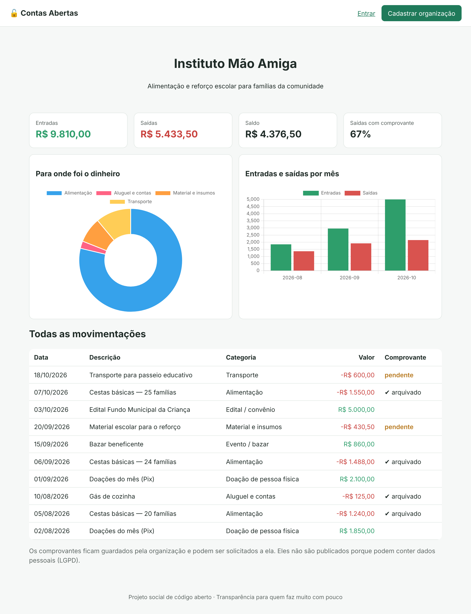

# 🔓 Contas Abertas

**Transparência financeira para quem faz muito com pouco.**

O Contas Abertas é um sistema web gratuito e de código aberto que ajuda **ONGs, associações de bairro e
projetos sociais pequenos** a registrar cada real recebido e gasto, guardar comprovantes e publicar
automaticamente uma **página pública de transparência**.



## O problema

O Brasil tem centenas de milhares de organizações da sociedade civil, e a maioria é pequena: funciona com
voluntários e orçamento curto. Essas organizações costumam:

- não ter dinheiro para pagar um contador;
- controlar as contas em cadernos ou planilhas confusas;
- perder doadores por não conseguir mostrar **para onde vai o dinheiro**;
- ter dificuldade para prestar contas em editais e convênios.

## A solução

| Funcionalidade | Para quê |
|---|---|
| Registro de entradas e saídas com categorias simples | Qualquer voluntário consegue usar, sem saber contabilidade |
| Foto ou PDF do comprovante (até pelo celular) | Organiza os documentos num só lugar |
| Painel com saldo, gráficos e % de gastos comprovados | Gestão do dia a dia |
| **Página pública de transparência** | Doadores e comunidade veem tudo, com gráficos |
| Exportação da planilha de prestação de contas | Facilita editais e convênios |
| Comprovantes não publicados | Proteção de dados pessoais (LGPD) |

## Quem é beneficiado

- **Organizações sociais pequenas:** menos tempo com papelada, mais credibilidade.
- **Doadores:** sabem exatamente como a doação foi usada.
- **Comunidade atendida:** organizações mais confiáveis recebem mais recursos.

## Tecnologias

- Python 3 + Flask
- SQLAlchemy (SQLite no desenvolvimento, PostgreSQL em produção)
- HTML + CSS responsivo (funciona no celular, tema claro/escuro) e Chart.js para os gráficos
- Pytest + GitHub Actions (testes automáticos a cada envio)
- Docker

## Como rodar

```bash
git clone https://github.com/Tokmogi/contas-abertas.git
cd contas-abertas
python -m venv .venv
source .venv/bin/activate      # no Windows: .venv\Scripts\activate
pip install -r requirements-dev.txt
python dados_exemplo.py        # cria uma ONG de demonstração (opcional)
python run.py
```

Acesse <http://localhost:5000>.
Login de demonstração: `demo@contasabertas.org` / `demonstracao`.

Para rodar os testes: `pytest`

Com Docker: `docker build -t contas-abertas . && docker run -p 8000:8000 contas-abertas`

## Estrutura

```
app/
  __init__.py     criação da aplicação
  models.py       Organizacao, Usuario, Lancamento
  auth.py         cadastro, login e logout
  painel.py       área da organização (lançamentos, comprovantes, exportação)
  publico.py      página inicial e portal de transparência
  utils.py        formatação de moeda e cálculo dos resumos
  templates/      telas (HTML)
docs/             documentação do projeto e relatório
tests/            testes automáticos
```

## Documentação

- [Problema social](docs/01-problema-social.md)
- [Proposta e objetivos](docs/02-proposta-e-objetivos.md)
- [Requisitos](docs/03-requisitos.md)
- [Arquitetura](docs/04-arquitetura.md)
- [Cronograma](docs/05-cronograma.md)
- [Relatório do projeto](docs/relatorio.md)
- [Post de divulgação no LinkedIn](docs/post-linkedin.md)

## Como contribuir

Toda ajuda é bem-vinda: código, design, testes com ONGs reais ou ideias. Veja o
[guia de contribuição](CONTRIBUTING.md) e as [issues abertas](https://github.com/Tokmogi/contas-abertas/issues).

## Licença

[MIT](LICENSE): use, copie e adapte à vontade.
