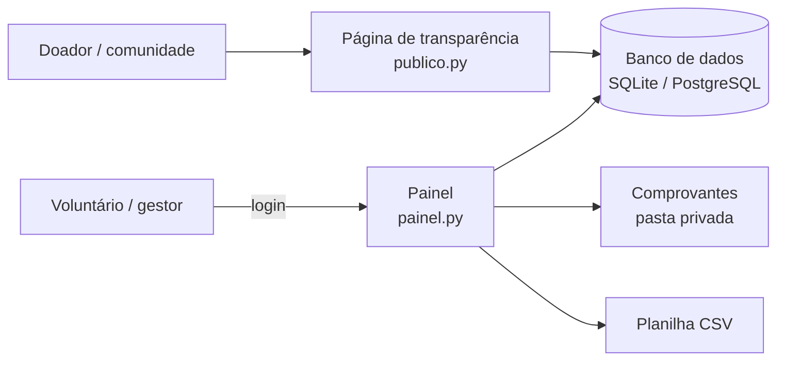
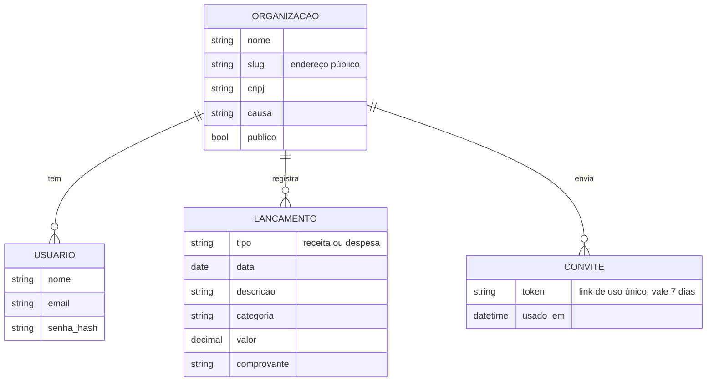

# 4. Arquitetura

## Visão geral

## Modelo de dados

## Decisões

| Decisão | Motivo |
|---|---|
| Flask (Python) | Simples, leve e fácil de aprender: bom para contribuidores iniciantes |
| Sem framework JavaScript | Menos complexidade; páginas rápidas em celulares simples |
| SQLite → PostgreSQL | Começa sem instalar nada; escala quando precisar |
| Valores em `Decimal` | Evita erros de arredondamento com dinheiro |
| Comprovantes fora da página pública | Podem conter CPF, endereço etc. (LGPD) |
| Categorias fixas e simples | Voluntários não precisam saber contabilidade |
| Convite por link, sem e-mail | Não exige servidor de e-mail; voluntários já usam WhatsApp |
| Relatório em HTML com "Imprimir / salvar em PDF" | Sem biblioteca extra; o navegador gera o PDF |
| CSRF próprio (token na sessão) | Protege formulários sem adicionar dependência |
